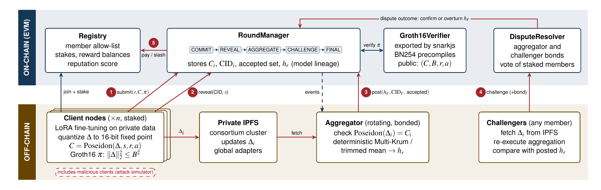

# ZK-FedChain

**Blockchain-governed federated fine-tuning of language models with zero-knowledge verified updates**

CSE 540 &middot; Group 30 &middot; Md Fahim Ul Islam, Faisal Al-Qahtani, Sri Vignesh Madasu, Meshari Alqahtani

> Status: **draft (smart-contract design milestone)**. Contract interfaces and
> the round logic are written and tested with a mock verifier. The ZK circuit
> compiles, and the off-chain nodes have their interfaces in place. Items still
> open are listed under [Project status](#project-status).

---

## 1. Project description

In federated learning (FL), several organizations fine-tune one shared model
while keeping their training data private. The usual protocol still needs a
central server that every participant trusts: the server decides which client
updates are merged, publishes the new model, and keeps the only record of who
contributed. Malicious clients can also poison the model with backdoored or
scaled updates.

ZK-FedChain replaces the trusted server with Ethereum smart contracts:

- Each client proves with a **Groth16 zero-knowledge proof** that its update
  stays within an agreed norm bound, without revealing the update. The
  `RoundManager` contract verifies the proof on-chain before accepting it.
- The contracts hold the **round state**, a tamper-evident **history of global
  model hashes**, member **stake**, **reputation** and **ERC-20 rewards**.
- Robust aggregation (Multi-Krum / trimmed mean) runs **off-chain**, is
  accepted optimistically, and can be **challenged** by any staked member.
- Model weights never go on-chain; the contracts only store Poseidon
  commitments, IPFS content identifiers (CIDs) and model hashes.

The first prototype targets DistilBERT with LoRA adapters on SST-2, with
10 to 20 simulated clients.



## 2. Smart-contract components

| Contract | Interface | Responsibility | Key functions |
|----------|-----------|----------------|---------------|
| `Registry` | `IRegistry` | Member allow-list, ETH stake, reputation, slashing | `addMember`, `depositStake`, `withdrawStake`, `slash`, `adjustReputation`, `lockStake`, `isEligible` |
| `RoundManager` | `IRoundManager` | Round state machine, proof check, model lineage, rewards | `startRound`, `submitUpdate`, `revealUpdate`, `postAggregate`, `advancePhase`, `finalizeRound`, `latestModel` |
| `Groth16Verifier` | `IGroth16Verifier` | Verifies the norm-bound proof (generated by snarkjs) | `verifyProof` |
| `DisputeResolver` | `IDisputeResolver` | Challenges against an aggregate, voting, bonds | `openChallenge`, `castVote`, `resolve` |
| `FedRewardToken` | `IFedRewardToken` | ERC-20 reward token (FCR), minted only by `RoundManager` | `mint` |
| `MockVerifier` | `IGroth16Verifier` | Test stand-in for the verifier before the circuit is ready | `verifyProof`, `setResult` |

Shared structs and enums (`Phase`, `Proof`, `RoundConfig`, `Round`,
`Submission`, `Dispute`) are in `contracts/libraries/FedTypes.sol`. Every
interface and contract carries NatSpec comments describing its purpose,
parameters and how it interacts with the other contracts.

**Round lifecycle.** `Commit -> Reveal -> Aggregate -> Challenge -> Finalized`
(or `Disputed -> Finalized`). Clients submit a commitment and proof, reveal
the IPFS CID of their update, the selected aggregator posts the new model
hash with a bond, and after the challenge window the round is finalized and
rewards are paid. The full protocol, sequence diagram and penalty table are in
[`docs/protocol.md`](docs/protocol.md).

## 3. Repository structure

```
zk-fedchain/
├── contracts/
│   ├── interfaces/          # IRegistry, IRoundManager, IDisputeResolver, IGroth16Verifier, IFedRewardToken
│   ├── libraries/FedTypes.sol
│   ├── Registry.sol
│   ├── RoundManager.sol
│   ├── DisputeResolver.sol
│   ├── FedRewardToken.sol
│   ├── mocks/MockVerifier.sol
│   └── verifier/            # Groth16Verifier.sol is generated here by the circuit build
├── circuits/
│   ├── norm_bound.circom    # range check + norm bound + Poseidon commitment
│   └── build_circuit.sh     # compile, trusted setup, export Solidity verifier
├── offchain/
│   ├── zkfed/               # Python client, aggregator, challenger, chain + IPFS helpers
│   ├── tests/               # unit tests for the aggregation rules
│   └── requirements.txt
├── scripts/deploy.js        # deploys and wires all contracts
├── test/RoundLifecycle.test.js
├── docs/                    # architecture figure and protocol notes
├── hardhat.config.js
├── package.json
└── .env.example
```

## 4. Dependencies

All tools are free and open source.

| Area | Tool | Version used |
|------|------|--------------|
| Runtime | Node.js, npm | Node 18 or newer (tested with 22) |
| Smart contracts | Solidity, Hardhat, Hardhat Toolbox (ethers v6, chai, gas reporter) | solc 0.8.24, Hardhat 2.x |
| Contract libraries | OpenZeppelin Contracts (`AccessControl`, `ReentrancyGuard`, `ERC20`) | 5.x |
| Zero-knowledge | circom, circomlib, snarkjs | circom 2.1.x, circomlib 2.0.5, snarkjs 0.7.x |
| Off-chain nodes | Python, numpy, web3.py, requests | Python 3.10 or newer |
| Model training | PyTorch, Hugging Face Transformers, PEFT, Datasets | see `offchain/requirements.txt` |
| Storage | IPFS (Kubo) | any recent release |
| Networks | Hardhat local network, Ethereum Sepolia testnet, Hyperledger Besu (optional) | |

## 5. Setup

```bash
git clone https://github.com/Fahim-ok/zk-fedchain.git
cd zk-fedchain

# JavaScript tool-chain (Hardhat, OpenZeppelin, snarkjs, circomlib)
npm install

# Compile the contracts and run the tests (uses MockVerifier)
npx hardhat compile
npx hardhat test

# Python environment for the off-chain nodes
python -m venv .venv
source .venv/bin/activate          # Windows: .venv\Scripts\activate
pip install -r offchain/requirements.txt
python -m pytest offchain/tests
```

To build the ZK circuit you also need the circom compiler. Install it with
Rust (`cargo install --git https://github.com/iden3/circom.git`) or use the
WebAssembly build (`npm install -g circom2`).

## 6. Usage and deployment

### 6.1 Local chain

```bash
npx hardhat node                                  # terminal 1: local chain on :8545
npx hardhat run scripts/deploy.js --network localhost   # terminal 2
```

`deploy.js` deploys `MockVerifier` (local only), `FedRewardToken`, `Registry`,
`RoundManager` and `DisputeResolver`, grants the roles between them, and
writes the addresses to `deployments/localhost.json`, which the Python nodes
read.

### 6.2 Build the circuit and the real verifier

```bash
npm run circuit:build                 # or: CIRCOM="npx circom2" npm run circuit:build
npx hardhat compile                   # now includes contracts/verifier/Groth16Verifier.sol
USE_REAL_VERIFIER=true npx hardhat run scripts/deploy.js --network localhost
```

The draft circuit uses `D = 1024` coordinates (about 57k constraints, so a
2^16 Powers of Tau file is enough). The script runs a development-only trusted
setup, which takes roughly 20 to 25 minutes on a laptop; placing a public
Powers of Tau file at `circuits/build/pot_final.ptau` skips most of that time
and is the right choice for a shared deployment.

### 6.3 Sepolia testnet

```bash
cp .env.example .env        # fill in SEPOLIA_RPC_URL and a test-only PRIVATE_KEY
npm run circuit:build && npx hardhat compile
npx hardhat run scripts/deploy.js --network sepolia
```

On non-local networks the script always deploys the real `Groth16Verifier`.

### 6.4 Running a round (planned workflow)

The off-chain nodes in `offchain/zkfed/` wrap the contract calls. The intended
flow, once LoRA training and the Poseidon re-check are finished, is:

```python
from offchain.zkfed.config import NodeConfig
from offchain.zkfed.chain import FedChain
from offchain.zkfed.client import FLClient
from offchain.zkfed.aggregator import Aggregator

admin = FedChain(NodeConfig(private_key="0x..."))
admin.start_round()
rid = admin.current_round()

client = FLClient(NodeConfig(private_key="0x..."), data_dir="offchain/data/client1")
client.run_round(rid)            # train, prove, submitUpdate, then revealUpdate

Aggregator(NodeConfig(private_key="0x...")).run_round(rid)   # Multi-Krum + postAggregate
admin.finalize_round(rid)        # after the challenge window
```

## 7. Project status

| Component | Status |
|-----------|--------|
| Contract interfaces (`contracts/interfaces/`) | Done |
| `Registry`, `RoundManager`, `DisputeResolver`, `FedRewardToken` | Draft written; 5 Hardhat tests pass with `MockVerifier` |
| Norm-bound circuit (`circuits/norm_bound.circom`) | Draft compiles; trusted setup script tested |
| End-to-end check (Python prover -> `RoundManager.submitUpdate` with the real verifier) | Checked manually: a valid proof is accepted (about 404k gas) and the same proof replayed by another member is rejected and slashed |
| Python chain/IPFS wrappers, prover, Multi-Krum / trimmed mean | Draft written; aggregation unit tests pass |
| LoRA training in `FLClient.train_local` | TODO |
| Poseidon re-check in `Aggregator.commitment_matches` | TODO |
| Attack simulation and evaluation (accuracy, attack success rate, gas) | TODO |
| Sepolia deployment and demo | TODO |

Known limitations of the draft, marked `TODO` in the code: aggregator
selection uses `block.prevrandao` (a VRF would be stronger), stake locks are
not yet extended during an open dispute, and clients of an overturned round
are not re-aggregated.

## 8. Team

| Member | Responsibility |
|--------|----------------|
| Md Fahim Ul Islam (lead) | Smart contracts and interfaces, Hardhat tests and deployment script, Circom circuit and trusted-setup script, verifier integration, Python off-chain nodes (client, aggregator, challenger, IPFS and web3.py), documentation, literature review, meetings |

## 9. License

MIT. See [LICENSE](LICENSE).
