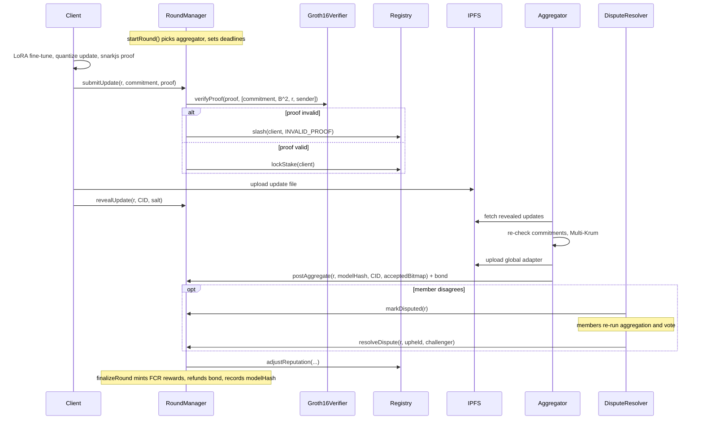

# ZK-FedChain round protocol

This note describes how the contracts and off-chain nodes interact in one
training round `r`. Function names refer to `contracts/interfaces/`.

## Roles

| Role | Who | Main calls |
|------|-----|-----------|
| Admin | Consortium governance (a multisig in practice) | `Registry.addMember`, `RoundManager.setConfig` |
| Client | Any staked member with private data | `submitUpdate`, `revealUpdate` |
| Aggregator | One staked member, picked by `RoundManager` each round | `postAggregate` |
| Challenger / voter | Any other staked member | `DisputeResolver.openChallenge`, `castVote`, `resolve` |
| Anyone | Keeper that moves deadlines forward | `startRound`, `advancePhase`, `finalizeRound` |

## Phases

```
None -> Commit -> Reveal -> Aggregate -> Challenge -> Finalized
                                            |
                                            +-> Disputed -> Finalized
```

| Phase | Ends when | What happens on exit |
|-------|-----------|----------------------|
| Commit | `commitDeadline` passes (`advancePhase`) | Round closes early if nobody submitted |
| Reveal | `revealDeadline` passes (`advancePhase`) | Clients that committed but did not reveal are slashed |
| Aggregate | aggregator calls `postAggregate`, or `aggregateDeadline` passes | On timeout the aggregator is slashed and the round closes |
| Challenge | `challengeDeadline` passes (`finalizeRound`) or a challenge is opened | Rewards paid, model hash recorded |
| Disputed | `DisputeResolver.resolve` after the voting deadline | Aggregate upheld -> normal settlement; overturned -> aggregator slashed, bond to challenger |

## Sequence



## Penalties follow the evidence

| Event | Evidence | Penalty |
|-------|----------|---------|
| Proof fails `verifyProof` | Cryptographic, checked by the contract | Stake slashed (`invalidProofPenalty`) |
| Commitment never revealed | Checked by the contract | Stake slashed (`noRevealPenalty`) |
| Aggregator never posts | Checked by the contract | Stake slashed (`aggregatorTimeoutPenalty`) |
| Aggregate overturned by vote | Re-execution by members | Stake slashed + bond lost (`badAggregatePenalty`) |
| Update dropped by Multi-Krum | Statistical only | Reputation -1, no slashing |

## Why the public signals come from the contract

`submitUpdate` builds the verifier input as
`[commitment, normBoundSq, roundId, uint160(msg.sender)]`.
Only the commitment comes from the caller. Because the round id and the
sender address are inside the proof, a proof cannot be replayed in a later
round or submitted by a different client, and because the commitment is
fixed before any update is revealed, a free-rider cannot copy another
client's update.
